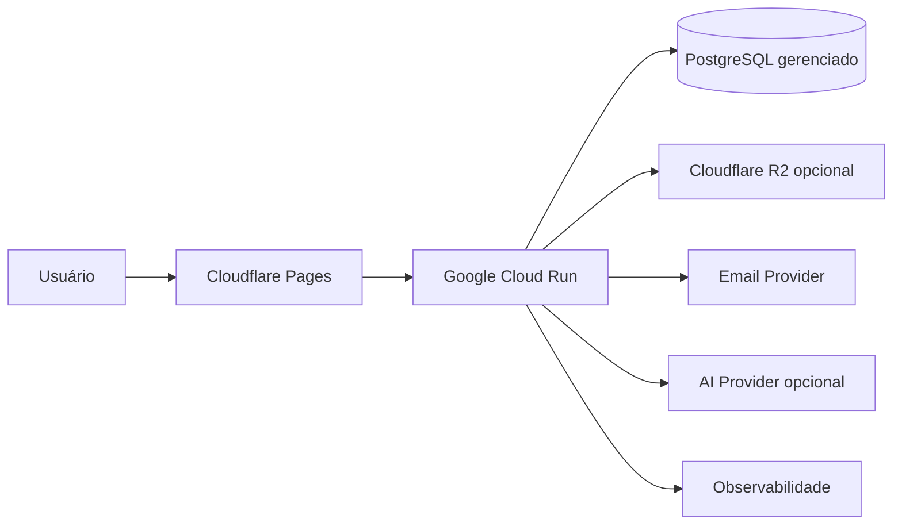

# ADR-0004 — Deployment cloud de baixo custo

## Status

Proposed

## Contexto

O NexoDesk precisa de preview, produção, TLS, observabilidade, backup e rollback
com orçamento reduzido. O frontend Angular é estático após o build, enquanto a
API Spring Boot exige runtime de container. Cloudflare Workers tradicional não
é runtime JVM e não deve forçar reescrita do backend em TypeScript.

## Decisão proposta

Adotar a topologia inicial:

- Angular em Cloudflare Pages;
- Spring Boot em container no Google Cloud Run;
- PostgreSQL gerenciado escolhido após validação de backup, RLS e conexões;
- Cloudflare R2 somente se anexos entrarem no piloto;
- provedor transacional de e-mail atrás de EmailGateway;
- provedor de IA atrás de AiGateway e feature flag;
- GitHub Actions para CI e promoção;
- infraestrutura declarada com OpenTofu ou Terraform.

## Ambientes

### Local

Docker Compose ou Testcontainers para dependências. Serviços externos usam
emuladores, fakes ou sandbox oficial.

### Preview

Frontend possui preview por branch. A API usa ambiente staging compartilhado e
dados sintéticos, evitando um banco por PR no MVP.

### Produção

Branch protegida, artefatos imutáveis e aprovação humana. Deploy registra
versão, migration e commit.

## Controles de custo

- Cloud Run com mínimo zero e máximo de instâncias definido;
- limite de concorrência validado por carga;
- pool de conexões pequeno e compatível com o proxy do PostgreSQL;
- orçamento e alertas antes do piloto;
- quotas por tenant para IA, e-mail e armazenamento;
- logs com retenção limitada e amostragem controlada;
- anexos e IA desligáveis por feature flag.

Os valores monetários e limites não são fixados neste ADR porque mudam. Devem
ser verificados nos preços oficiais quando a decisão for aceita.

## Rede e segurança

- somente API exposta publicamente;
- banco exige TLS e não aceita origem irrestrita quando o provedor permitir;
- segredos no Secret Manager do runtime, nunca em arquivo ou GitHub variable
  não secreta;
- CORS limitado aos domínios oficiais e previews aprovados;
- headers de segurança no frontend;
- imagens executadas sem root quando compatível;
- imagem base fixada por digest e verificada no CI.

## Deploy e migrations

1. CI compila, testa e verifica dependências.
2. Uma imagem é criada uma vez e identificada pelo commit.
3. Job controlado executa migration compatível.
4. A mesma imagem é promovida.
5. Readiness confirma banco e configuração essencial.
6. Falha retorna tráfego à revisão anterior.

Migration destrutiva exige estratégia expand-and-contract e não ocorre junto de
código que dependa imediatamente da remoção.

## Observabilidade e recuperação

- logs JSON com correlation ID e tenant pseudonimizado;
- métricas de RED para API e filas;
- error tracking sem conteúdo sensível;
- health checks de liveness e readiness;
- backup diário e restore ensaiado;
- runbook de indisponibilidade de banco, e-mail e IA;
- revisão anterior do Cloud Run como rollback operacional.

## Alternativas consideradas

### Tudo em Cloudflare Workers

Pode reduzir custo, mas exigiria abandonar Spring Boot/JVM ou introduzir runtime
não comprovado. Não atende ao objetivo técnico atual.

### VPS única

Custo previsível, porém exige patching, TLS, monitoramento, backup e alta
disponibilidade manuais.

### Kubernetes

Rejeitado por complexidade e custo sem demanda comprovada.

### Plataformas PaaS alternativas

Render, Railway, Koyeb, Fly.io e similares podem substituir Cloud Run se preço,
região ou experiência operacional forem melhores na validação. A aplicação não
deve depender de API proprietária de runtime.

## Consequências positivas

- frontend global de baixo custo;
- backend preserva Java e pode escalar a zero;
- serviços externos ficam atrás de portas;
- deploy e rollback reproduzíveis;
- caminho para crescer sem Kubernetes.

## Consequências negativas

- cold start da JVM pode afetar a primeira requisição;
- vários provedores aumentam configuração e observabilidade;
- escala a zero e PostgreSQL exigem cuidado com conexões;
- staging compartilhado limita isolamento de previews.

## Validação antes de Accepted

- medir cold start com imagem real;
- testar conexão, pool e RLS no PostgreSQL candidato;
- verificar backup, restore, região e preço vigentes;
- executar carga mínima e estimar custo;
- provar deploy e rollback;
- confirmar que frontend e API funcionam com CORS e domínio final.
