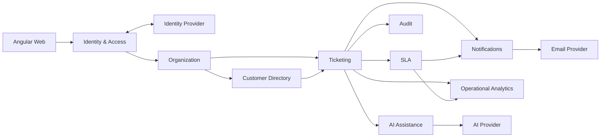
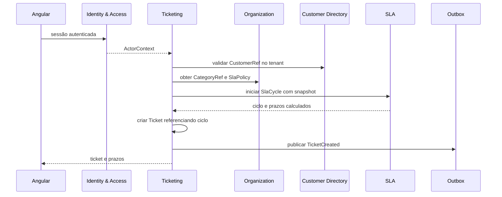
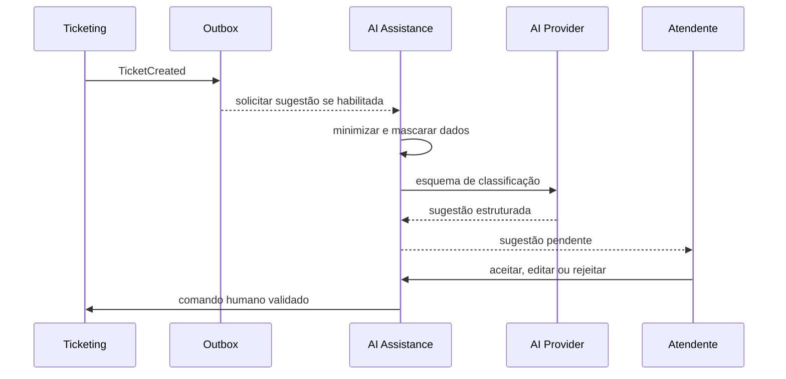

# NexoDesk — Mapa de contextos

## Controle

| Campo              | Valor                 |
| ------------------ | --------------------- |
| Status             | Draft                 |
| Base               | PRD do MVP v1.0       |
| Escopo             | MVP                   |
| Última atualização | 15 de outubro de 2026 |

## 1. Objetivo

Este documento define os limites de negócio do NexoDesk, a direção das
dependências e os contratos entre contextos. Ele evita que conceitos de
autenticação, atendimento, SLA, notificações, IA e analytics sejam misturados
em um único modelo.

O MVP será entregue como monólito modular proposto. Os limites abaixo são
limites lógicos e de código, não microserviços.

## 2. Visão geral

## 3. Classificação dos subdomínios

| Contexto              | Tipo       | Razão                                                     |
| --------------------- | ---------- | --------------------------------------------------------- |
| Ticketing             | Core       | Contém o ciclo operacional e o principal valor do produto |
| SLA                   | Core       | Diferencia acompanhamento e responsabilidade              |
| Organization          | Supporting | Configura tenant, categorias e políticas                  |
| Customer Directory    | Supporting | Mantém identidade local e histórico do atendido           |
| AI Assistance         | Supporting | Reduz trabalho, mas o produto funciona sem ele            |
| Operational Analytics | Supporting | Transforma eventos em visibilidade gerencial              |
| Identity & Access     | Generic    | Autenticação e autorização usam padrões consolidados      |
| Notifications         | Generic    | Entrega e-mail a partir de eventos                        |
| Audit                 | Generic    | Preserva rastreabilidade de ações críticas                |

## 4. Contextos

### 4.1 Identity & Access

**Responsabilidade:** autenticar identidades e converter claims externos em um
ator autorizado no tenant correto.

**Possui:**

- referência local de User;
- Membership de ADMIN ou AGENT;
- PortalAccess de CUSTOMER;
- convites, estado de acesso e revogação.

**Não possui:**

- senha ou token quando a autenticação for delegada;
- perfil detalhado do cliente;
- regras de ticket.

**Publica:**

- MemberInvited;
- MemberActivated;
- MemberDeactivated;
- PortalAccessActivated.

### 4.2 Organization

**Responsabilidade:** administrar o tenant e configurações compartilhadas.

**Possui:**

- Organization;
- slug público;
- fuso horário;
- Category;
- SlaPolicy versionada;
- feature flags e configurações seguras.

**Publica:**

- OrganizationCreated;
- CategoryChanged;
- SlaPolicyChanged;
- FeatureFlagChanged.

### 4.3 Customer Directory

**Responsabilidade:** representar a pessoa atendida dentro da organização.

**Possui:**

- Customer;
- nome, e-mail normalizado e estado;
- referência opcional ao acesso de portal.

**Não possui:**

- credencial;
- conversas;
- métricas agregadas.

**Publica:**

- CustomerCreated;
- CustomerUpdated;
- CustomerDeactivated.

### 4.4 Ticketing

**Responsabilidade:** executar o ciclo completo da solicitação.

**Possui:**

- Ticket;
- prioridade, estado, categoria e responsável;
- Interaction pública ou interna;
- regras de transição;
- referência ao SlaCycle ativo;
- referência de satisfação.

**Consome:**

- Membership ativa de Identity & Access;
- Customer de Customer Directory;
- Category e SlaPolicy de Organization.

**Publica:**

- TicketCreated;
- TicketAssigned;
- TicketClassified;
- TicketStatusChanged;
- PublicReplyAdded;
- InternalNoteAdded;
- TicketResolved;
- TicketReopened;
- TicketClosed.

Ticketing não envia e-mail diretamente, não chama IA dentro da transação e não
calcula dashboards sincronamente.

### 4.5 SLA

**Responsabilidade:** calcular e acompanhar primeira resposta e resolução.

**Possui:**

- SlaCycle e snapshot da política aplicada;
- cálculo de deadline;
- pausas e retomadas;
- estado ON_TRACK, AT_RISK ou BREACHED;
- fechamento de ciclos;
- jobs idempotentes de risco e violação.

**Consome:**

- comandos transacionais de criação, resposta, estado, prioridade e resolução;
- snapshot versionado de SlaPolicy.

**Publica:**

- FirstResponseMet;
- SlaAtRisk;
- SlaBreached;
- ResolutionCycleCompleted.

### 4.6 Notifications

**Responsabilidade:** transformar eventos aprovados em mensagens transacionais.

**Possui:**

- template;
- destinatário;
- preferência;
- estado de entrega;
- tentativas e idempotência.

Usa uma anti-corruption layer para o provedor de e-mail. Falha de entrega não
reverte a operação de negócio que originou o evento.

### 4.7 Audit

**Responsabilidade:** registrar ações relevantes em formato append-only.

Audit recebe comandos ou eventos sanitizados. Nunca deve registrar senha,
token, segredo ou conteúdo completo desnecessário.

### 4.8 Operational Analytics

**Responsabilidade:** produzir contagens e métricas definidas no PRD.

No MVP, pode consultar read models no mesmo PostgreSQL. Não deve redefinir FRT,
MTTR, SLA ou CSAT; as fórmulas pertencem à linguagem do produto.

### 4.9 AI Assistance

**Responsabilidade:** gerar sugestões não vinculantes para classificação e
resumo.

**Possui:**

- AiSuggestion;
- versão do prompt e modelo;
- confiança;
- decisão humana;
- medição de uso e custo.

Usa uma anti-corruption layer para o provedor de IA. Conteúdo do ticket é dado
não confiável e nunca instrução para o sistema.

## 5. Relações entre contextos

| Upstream           | Downstream     | Relação               | Contrato                           |
| ------------------ | -------------- | --------------------- | ---------------------------------- |
| Identity & Access  | Todos          | Conformist controlado | ActorContext imutável              |
| Organization       | Ticketing      | Customer/Supplier     | CategoryRef e SlaPolicySnapshot    |
| Customer Directory | Ticketing      | Customer/Supplier     | CustomerRef                        |
| Ticketing          | SLA            | Partnership           | SlaLifecycle e eventos versionados |
| Ticketing          | Notifications  | Published Language    | Eventos via outbox                 |
| Ticketing          | Audit          | Published Language    | Audit facts sanitizados            |
| Ticketing e SLA    | Analytics      | Published Language    | Eventos e read models              |
| Ticketing          | AI Assistance  | Open Host Service     | Solicitação assíncrona e opcional  |
| Notifications      | Email Provider | Anti-Corruption Layer | EmailGateway                       |
| AI Assistance      | AI Provider    | Anti-Corruption Layer | AiGateway                          |

## 6. Dependências permitidas

- Módulos de negócio dependem somente de contratos e tipos compartilhados
  mínimos.
- Ticketing pode referenciar IDs e snapshots de Organization e Customer
  Directory, mas não suas entidades persistentes.
- Adaptadores externos dependem das portas do módulo; o domínio não depende de
  SDK de provedor.
- Analytics e Notifications dependem de eventos publicados, não de chamadas
  internas ao domínio.
- Nenhum módulo contorna Identity & Access para aceitar tenant informado pelo
  cliente.

## 7. Fluxos entre contextos

### 7.1 Criação de ticket

### 7.2 Sugestão de IA

## 8. Ownership de dados

Cada tabela pertence a exatamente um contexto. Foreign keys físicas entre
contextos podem existir no monólito, mas não autorizam acesso direto ao modelo
interno do módulo. Integrações em código usam portas, referências imutáveis ou
eventos.

| Dado                                        | Owner                 |
| ------------------------------------------- | --------------------- |
| users, memberships, portal_access           | Identity & Access     |
| organizations, categories, sla_policies     | Organization          |
| customers                                   | Customer Directory    |
| tickets, interactions, satisfaction_surveys | Ticketing             |
| sla_cycles                                  | SLA                   |
| notifications, delivery_attempts            | Notifications         |
| audit_events                                | Audit                 |
| ai_suggestions, ai_usage                    | AI Assistance         |
| operational_read_models                     | Operational Analytics |
| outbox_events                               | Platform              |

## 9. Regras de evolução

- Extração futura para serviço é considerada somente com evidência de escala,
  isolamento operacional ou ritmo de mudança independente.
- Um novo contexto exige linguagem própria, owner claro e contrato explícito.
- Comunicação síncrona interna não pode criar ciclos entre módulos.
- Eventos são versionados e consumidores devem tolerar campos adicionais.
- Mudança de owner de dado exige ADR e plano de migração.

## 10. Questões para validação

- Quais operações de Ticketing e SLA precisam compartilhar a mesma transação?
- CSAT pertence a Ticketing no MVP e migra para Analytics no futuro?
- O provedor de identidade suporta os fluxos de convite e portal sem acoplar o
  domínio ao seu SDK?
- Quais eventos precisam de garantia at-least-once antes do primeiro piloto?

As respostas devem ser consolidadas no modelo de domínio e nos ADRs antes da
implementação do Slice 0.
