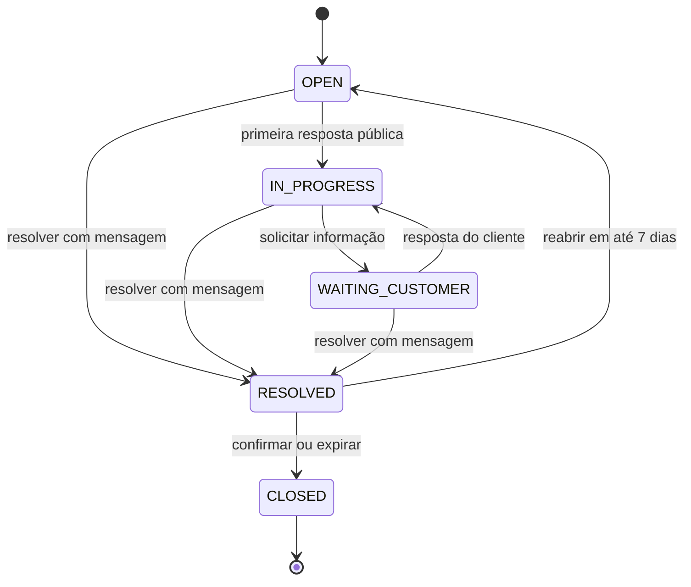

# NexoDesk — Modelo de domínio do MVP

## Controle

| Campo              | Valor                                 |
| ------------------ | ------------------------------------- |
| Status             | Draft                                 |
| Base               | PRD do MVP v1.0 e mapa de contextos   |
| Escopo             | Modelo conceitual, sem decisão de ORM |
| Última atualização | 15 de outubro de 2026                 |

## 1. Linguagem ubíqua

| Termo             | Definição                                                          |
| ----------------- | ------------------------------------------------------------------ |
| Organização       | Empresa cliente e limite de isolamento do tenant                   |
| Integrante        | Usuário interno associado a uma organização                        |
| Administrador     | Integrante que configura e governa a organização                   |
| Atendente         | Integrante que executa o atendimento                               |
| Cliente           | Pessoa que recebe atendimento dentro de uma organização            |
| Ticket            | Solicitação rastreável com responsável, estado, prioridade e prazo |
| Interação pública | Mensagem visível à equipe e ao cliente                             |
| Nota interna      | Mensagem visível apenas à equipe                                   |
| Categoria         | Classificação configurada pela organização                         |
| Política de SLA   | Metas versionadas por prioridade                                   |
| Ciclo de SLA      | Medição de uma tentativa de resolução                              |
| Primeira resposta | Primeira interação pública feita por integrante                    |
| Resolução         | Declaração da equipe de que a solicitação foi solucionada          |
| Fechamento        | Encerramento terminal após confirmação ou prazo de reabertura      |
| Reabertura        | Retorno de RESOLVED para OPEN dentro de 7 dias                     |
| Sugestão de IA    | Recomendação não vinculante sujeita a decisão humana               |

Palavras como chamado, demanda e solicitação podem aparecer na comunicação de
marketing, mas o código e os contratos usam Ticket.

## 2. Identidade e tenant

### 2.1 Tipos de identidade

- **UserId:** identidade global autenticada, externa ao domínio.
- **OrganizationId:** tenant imutável da operação.
- **MembershipId:** associação interna de User a Organization.
- **CustomerId:** pessoa atendida no tenant.
- **PortalAccessId:** associação de User a Customer no portal.
- **ActorId:** união tipada de MembershipId, PortalAccessId ou SystemActor.

### 2.2 ActorContext

Todo caso de uso recebe um ActorContext construído na borda autenticada:

| Campo          | Regra                                   |
| -------------- | --------------------------------------- |
| userId         | Identidade verificada pelo provedor     |
| organizationId | Resolvido de Membership ou PortalAccess |
| actorId        | Identidade local usada em autoria       |
| actorType      | ADMIN, AGENT, CUSTOMER ou SYSTEM        |
| permissions    | Conjunto derivado no servidor           |
| correlationId  | Identificador da requisição             |

OrganizationId nunca é aceito como autoridade a partir de payload, header livre
ou parâmetro do cliente.

## 3. Agregados

### 3.1 Organization

**Aggregate root:** Organization

**Estado:**

- OrganizationId;
- legalName;
- displayName;
- slug;
- timezone;
- status: ACTIVE ou INACTIVE;
- feature flags;
- createdAt e updatedAt;
- version.

**Invariantes:**

- slug é globalmente único, normalizado e imutável depois do piloto;
- timezone deve ser identificador IANA válido;
- organização inativa não aceita login, convite ou mutação de negócio;
- criação provisiona configuração padrão de modo idempotente.

**Comandos:**

- CreateOrganization;
- ChangeOrganizationSettings;
- ActivateFeature;
- DeactivateOrganization.

**Eventos:**

- OrganizationCreated;
- OrganizationSettingsChanged;
- OrganizationDeactivated;
- FeatureFlagChanged.

### 3.2 Membership

**Aggregate root:** Membership

**Estado:**

- MembershipId;
- OrganizationId;
- UserId opcional até aceite;
- invitedEmail normalizado;
- role: ADMIN ou AGENT;
- status: INVITED, ACTIVE, DISABLED ou EXPIRED;
- invitationTokenHash;
- invitationExpiresAt;
- createdAt, activatedAt e disabledAt;
- version.

**Invariantes:**

- e-mail ativo ou convidado é único por organização;
- convite expira em 72 horas e só pode ser consumido uma vez;
- organização deve manter pelo menos um ADMIN ativo;
- apenas ADMIN ativo pode convidar ou desativar;
- desativação não apaga autoria histórica.

### 3.3 PortalAccess

**Aggregate root:** PortalAccess

**Estado:**

- PortalAccessId;
- OrganizationId;
- CustomerId;
- UserId;
- verifiedEmail;
- status: PENDING, ACTIVE ou DISABLED;
- verificationTokenHash e expiresAt;
- createdAt e activatedAt;
- version.

**Invariantes:**

- um Customer possui no máximo um acesso ativo na organização;
- acesso só ativa com e-mail verificado;
- token expira em 30 minutos e é single-use;
- desativar Customer desativa o acesso correspondente.

### 3.4 Customer

**Aggregate root:** Customer

**Estado:**

- CustomerId;
- OrganizationId;
- name;
- normalizedEmail;
- status: ACTIVE ou INACTIVE;
- createdBy;
- createdAt e updatedAt;
- version.

**Invariantes:**

- e-mail é único por organização;
- cliente com ticket não pode ser removido fisicamente;
- cliente inativo permanece consultável no histórico e não abre novo ticket.

### 3.5 Category

**Aggregate root:** Category

**Estado:**

- CategoryId;
- OrganizationId;
- name;
- status: ACTIVE ou INACTIVE;
- isDefault;
- createdAt e updatedAt;
- version.

**Invariantes:**

- nome normalizado é único por organização;
- exatamente uma categoria padrão ativa deve existir;
- categoria referenciada não é excluída;
- inativa não pode ser aplicada a novo ticket.

### 3.6 SlaPolicy

**Aggregate root:** SlaPolicy

**Estado:**

- SlaPolicyId;
- OrganizationId;
- priority;
- versionNumber;
- firstResponseTarget;
- resolutionTarget;
- effectiveFrom;
- status: ACTIVE ou SUPERSEDED.

**Invariantes:**

- existe uma versão ativa por prioridade no tenant;
- metas são inteiros positivos em horas;
- resolução é maior ou igual à primeira resposta;
- alterar cria nova versão, sem editar snapshots históricos.

### 3.7 Ticket

**Aggregate root:** Ticket

**Estado:**

- TicketId;
- OrganizationId;
- TicketNumber;
- CustomerId;
- CategoryId;
- AssigneeMembershipId opcional;
- title;
- description;
- priority;
- status;
- source;
- createdBy;
- firstPublicAgentReplyAt opcional;
- resolvedAt opcional;
- reopenUntil opcional;
- closedAt opcional;
- activeSlaCycleId;
- createdAt e updatedAt;
- version.

**Invariantes:**

- Customer, Category e Assignee pertencem ao mesmo tenant;
- Assignee deve ser integrante ativo;
- título e descrição respeitam limites do PRD;
- apenas transições autorizadas são aceitas;
- resolver exige mensagem pública de resolução na mesma transação;
- ticket CLOSED não recebe interação ou mudança;
- reabertura ocorre somente até reopenUntil;
- concorrência usa versão otimista.

**Comandos:**

- CreateInternalTicket;
- CreatePortalTicket;
- AssignTicket;
- ChangeClassification;
- AddPublicReply;
- AddInternalNote;
- WaitForCustomer;
- ResolveTicket;
- ReopenTicket;
- CloseExpiredTicket.

**Eventos:**

- TicketCreated;
- TicketAssigned;
- TicketClassificationChanged;
- PublicReplyAdded;
- InternalNoteAdded;
- TicketStatusChanged;
- TicketResolved;
- TicketReopened;
- TicketClosed.

### 3.8 Interaction

Interaction é entidade append-only gravada na mesma transação do comando de
Ticket, sem compor uma coleção carregada inteira no agregado.

**Estado:**

- InteractionId;
- OrganizationId;
- TicketId;
- type: PUBLIC_REPLY, INTERNAL_NOTE ou RESOLUTION;
- author ActorId;
- body;
- createdAt.

**Invariantes:**

- conteúdo possui entre 1 e 10.000 caracteres;
- INTERNAL_NOTE exige ator interno;
- CUSTOMER só cria PUBLIC_REPLY no próprio ticket;
- interaction não é editada nem excluída;
- RESOLUTION só existe junto de transição válida para RESOLVED.

### 3.9 SlaCycle

**Aggregate root:** SlaCycle, pertencente ao contexto SLA.

**Estado:**

- SlaCycleId;
- OrganizationId;
- TicketId;
- cycleNumber;
- SlaPolicySnapshot;
- startedAt;
- firstResponseDueAt;
- firstRespondedAt opcional;
- resolutionDueAt;
- totalPausedDuration;
- pausedAt opcional;
- completedAt opcional;
- completion: MET, BREACHED ou CANCELED;
- version.

**Invariantes:**

- cycleNumber é sequencial por Ticket;
- somente um ciclo ativo por Ticket;
- primeira resposta é registrada uma vez no primeiro ciclo;
- pausa só inicia em WAITING_CUSTOMER;
- pausa aberta deve ser encerrada antes de completar;
- reabertura cria novo ciclo e preserva o anterior;
- cálculo usa instantes UTC e durações, nunca hora local.

### 3.10 SatisfactionSurvey

**Aggregate root:** SatisfactionSurvey

**Estado:**

- SatisfactionSurveyId;
- OrganizationId;
- TicketId;
- SlaCycleId;
- CustomerId;
- rating de 1 a 5 opcional;
- comment opcional;
- status: PENDING, ANSWERED ou EXPIRED;
- submittedAt opcional.

**Invariantes:**

- existe no máximo uma pesquisa por ciclo resolvido;
- somente Customer do Ticket responde;
- resposta é aceita uma vez;
- comentário possui no máximo 1.000 caracteres.

### 3.11 AiSuggestion

**Aggregate root:** AiSuggestion

**Estado:**

- AiSuggestionId;
- OrganizationId;
- TicketId;
- type;
- suggestedCategoryId;
- suggestedPriority;
- summary;
- confidence;
- provider;
- model;
- promptVersion;
- status: PENDING, ACCEPTED, EDITED, REJECTED ou FAILED;
- decidedBy e decidedAt opcionais;
- usage e estimatedCost;
- createdAt;
- version.

**Invariantes:**

- sugestão nunca modifica Ticket diretamente;
- decisão exige ADMIN ou AGENT no mesmo tenant;
- categoria sugerida deve existir e estar ativa;
- uma decisão terminal não pode ser substituída;
- falha não bloqueia o fluxo de Ticket.

## 4. Máquina de estados do ticket



### 4.1 Guard conditions

| Transição                      | Guarda                                           |
| ------------------------------ | ------------------------------------------------ |
| OPEN → IN_PROGRESS             | ator interno adicionou primeira resposta pública |
| OPEN ou IN_PROGRESS → RESOLVED | ator interno e mensagem de resolução             |
| IN_PROGRESS → WAITING_CUSTOMER | ator interno e justificativa pública             |
| WAITING_CUSTOMER → IN_PROGRESS | interação pública do cliente                     |
| RESOLVED → OPEN                | ator autorizado, instante <= reopenUntil         |
| RESOLVED → CLOSED              | confirmação do cliente ou job após reopenUntil   |

## 5. Objetos de valor

| Value Object      | Validação                                           |
| ----------------- | --------------------------------------------------- |
| EmailAddress      | sintaxe, normalização e comparação case-insensitive |
| OrganizationSlug  | lowercase, hífen, 3 a 50 caracteres                 |
| TicketNumber      | sequencial positivo e formatado por tenant          |
| TicketTitle       | 5 a 160 caracteres após trim                        |
| MessageBody       | 1 a 10.000 caracteres                               |
| Priority          | LOW, MEDIUM, HIGH ou CRITICAL                       |
| DurationHours     | inteiro positivo com limite operacional             |
| SlaPolicySnapshot | política e metas imutáveis usadas no ciclo          |
| ActorContext      | identidade, tenant, ator e permissões verificadas   |
| CorrelationId     | identificador opaco propagado entre operações       |
| IdempotencyKey    | valor opaco com escopo de ator e operação           |

## 6. Serviços de domínio

### 6.1 TicketAuthorizationPolicy

Decide ações permitidas por ator e Ticket sem depender de framework web.

### 6.2 SlaCalculator

Calcula deadlines, consumo, pausas, risco e violação a partir de instantes e
snapshot. Deve ser função determinística com relógio injetado.

### 6.3 TicketNumberGenerator

Gera sequência por tenant sem duplicidade sob concorrência.

### 6.4 PortalIdentityLinker

Vincula e-mail verificado a Customer existente ou cria Customer e PortalAccess
atomicamente, sem revelar existência anterior.

### 6.5 AiDataMinimizer

Constrói a entrada permitida para IA, mascarando dados não necessários e
recusando campos fora da allowlist.

## 7. Eventos e consistência

### 7.1 Transação local

Comando, mudança do agregado, evento de auditoria necessário e mensagem de
outbox são persistidos na mesma transação PostgreSQL.

### 7.2 Consistência eventual

Notificações, read models analíticos, sugestões de IA e alertas de SLA podem ser
processados após o commit. Consumidores devem ser idempotentes e assumir
entrega at-least-once.

### 7.3 Envelope de evento

Todo evento publicado possui:

- eventId;
- eventType e schemaVersion;
- occurredAt;
- organizationId;
- aggregateType e aggregateId;
- aggregateVersion;
- correlationId e causationId;
- payload mínimo e sem segredo.

## 8. Modelo conceitual

```mermaid
classDiagram
    Organization \"1\" --> \"*\" Membership
    Organization \"1\" --> \"*\" Customer
    Organization \"1\" --> \"*\" Category
    Organization \"1\" --> \"*\" SlaPolicy
    Customer \"1\" --> \"0..1\" PortalAccess
    Customer \"1\" --> \"*\" Ticket
    Category \"1\" --> \"*\" Ticket
    Membership \"0..1\" --> \"*\" Ticket : assigned
    Ticket \"1\" --> \"*\" Interaction
    Ticket \"1\" --> \"*\" SlaCycle
    Ticket \"1\" --> \"*\" AiSuggestion
    Ticket \"1\" --> \"*\" SatisfactionSurvey
```

O diagrama expressa relações de domínio, não autorização para navegação direta
entre módulos ou estratégia de carregamento do ORM.

## 9. Regras de persistência

- IDs são opacos e globalmente únicos; número de Ticket é legível e local.
- Todas as tabelas de negócio possuem organization_id não nulo.
- Unique constraints incluem organization_id quando a unicidade é local.
- Referências multi-tenant usam restrições que impedem combinação entre tenants.
- Interactions, AuditEvents e versões de política são append-only.
- Exclusão lógica usa status e timestamp, não flag genérica sem semântica.
- Timestamps são UTC e gerados pelo servidor.
- Versão otimista protege agregados mutáveis.
- Payload de outbox é versionado e removido conforme política operacional.

## 10. Cenários críticos de domínio

### 10.1 Concorrência de atribuição

Duas pessoas carregam a mesma versão do Ticket. A primeira atribuição incrementa
a versão; a segunda recebe conflito e deve recarregar antes de decidir. O
sistema não aplica last-write-wins silencioso.

### 10.2 Resposta e primeira resposta

Criar Interaction pública, registrar firstPublicAgentReplyAt, mover estado e
encerrar meta de primeira resposta ocorrem em uma operação atômica.

### 10.3 Pausa de SLA

WAITING_CUSTOMER abre uma pausa no ciclo. Resposta do cliente fecha a pausa,
acumula a duração e recalcula resolutionDueAt. Repetição do mesmo evento não
duplica tempo.

### 10.4 Reabertura

O ciclo encerrado permanece imutável. Reabrir cria outro SlaCycle, move Ticket
para OPEN e publica evento único. FRT original não é reiniciado.

### 10.5 Fechamento automático

Job busca candidatos por reopenUntil, tenta transição condicionada à versão e
publica evento apenas quando alterou. Reexecução é segura.

### 10.6 Falha da IA

Timeout ou erro grava AiSuggestion FAILED com metadados seguros. Ticket continua
disponível e pode ser classificado manualmente.

## 11. Testes obrigatórios do domínio

- tabela completa de transições válidas e inválidas;
- limites de título, corpo, comentário e metas;
- cálculo de SLA com múltiplas pausas;
- mudança de prioridade e snapshot;
- reabertura antes, no instante e depois do limite;
- fechamento idempotente;
- concorrência otimista de atribuição;
- vínculo de portal sem enumeração;
- invariantes de último ADMIN;
- todas as relações cross-tenant rejeitadas;
- decisão de IA sem mutação automática;
- serialização de eventos compatível com schemaVersion.

## 12. Decisões ainda abertas

- estratégia física de enforcing multi-tenant no PostgreSQL;
- provedor de identidade e formato exato das claims;
- limite máximo de integrantes, clientes e tickets no piloto;
- política final de retenção e anonimização;
- ownership definitivo de SatisfactionSurvey após o MVP;
- estratégia de busca textual;
- granularidade dos snapshots de SLA.

Esses pontos devem ser resolvidos por ADR ou especificação técnica antes de
afetarem uma implementação.
