# Processo de desenvolvimento

## Objetivo

Entregar mudanças pequenas, rastreáveis e reversíveis, mantendo especificação,
código, testes e operação no mesmo fluxo de revisão.

## Modelo de branches

O projeto usa **GitHub Flow**, não o GitFlow clássico. `main` representa o
estado integrável e potencialmente promovível. Não existem branches permanentes
de `develop`, `release` ou `hotfix`.

Branches de trabalho têm vida curta:

| Tipo        | Exemplo                    | Uso                               |
| ----------- | -------------------------- | --------------------------------- |
| `feat/`     | `feat/ticket-creation`     | Novo comportamento                |
| `fix/`      | `fix/sla-pause`            | Correção de defeito               |
| `docs/`     | `docs/threat-model`        | Especificação ou documentação     |
| `refactor/` | `refactor/ticket-boundary` | Mudança interna sem comportamento |
| `chore/`    | `chore/update-tooling`     | Manutenção                        |

## Fluxo SDD até produção

```mermaid
flowchart LR
    S[Spec e critérios] --> I[Issue]
    I --> B[Branch curta]
    B --> C[Código e testes]
    C --> PR[Pull request]
    PR --> CI[CI obrigatório]
    CI --> PV[Preview ou staging]
    PV --> M[Merge em main]
    M --> ST[Deploy staging]
    ST --> AP[Aprovação]
    AP --> PD[Produção]
```

1. A especificação identifica comportamento e critérios verificáveis.
2. A issue delimita a fatia vertical e referencia a fonte de verdade.
3. A branch implementa código, testes, contrato e documentação juntos.
4. O pull request demonstra rastreabilidade e risco.
5. O CI bloqueia integração inválida.
6. Preview ou staging permite validação funcional.
7. O mesmo artefato imutável é promovido, sem recompilação para produção.

## Política de commits e merge

- novos commits seguem Conventional Commits;
- título do pull request também segue a convenção;
- o merge padrão é **Squash and merge**;
- o título convencional do PR torna-se o commit na `main`;
- mudanças incompatíveis usam `!` e explicam a migração;
- commits antigos não são reescritos apenas para adequação cosmética.

Tipos aceitos: `feat`, `fix`, `docs`, `test`, `refactor`, `perf`, `style`,
`build`, `ci`, `chore` e `revert`.

## Quality gates

O pipeline cresce junto com o produto:

| Fase                 | Checks obrigatórios                                             |
| -------------------- | --------------------------------------------------------------- |
| Fundação atual       | formato, Markdown, estrutura, commits e título do PR            |
| Angular inicializado | lint, type-check, testes unitários, build e orçamento de bundle |
| API inicializada     | compilação, testes, ArchUnit, migrations e análise estática     |
| Container            | SBOM, scan de vulnerabilidades, execução sem root e smoke test  |
| Deploy               | readiness, migration compatível, observabilidade e rollback     |

Checks não devem ser removidos para liberar uma entrega. Exceções urgentes
precisam de justificativa registrada e correção posterior rastreável.

## Proteção esperada da `main`

As configurações abaixo devem ser ativadas em **Settings > Rules > Rulesets** no
GitHub. Elas são configuração do repositório e não podem ser impostas somente
pelos arquivos versionados:

- exigir pull request antes do merge;
- exigir pelo menos uma aprovação quando houver mais de um mantenedor;
- invalidar aprovação após novos commits;
- exigir resolução de todas as conversas;
- exigir os checks `Repository quality` e `Commit policy`;
- exigir branch atualizada antes do merge quando houver risco de conflito;
- bloquear force push e exclusão da `main`;
- aplicar as regras também aos administradores;
- permitir apenas Squash merge e excluir branch após o merge.

Até essas regras serem ativadas, a proteção é uma convenção, não uma barreira
técnica no GitHub.

## Releases e ambientes

- versões seguem SemVer quando existir primeiro artefato implantável;
- tags são criadas pelo processo de release, nunca movidas;
- previews usam dados sintéticos;
- staging recebe a revisão candidata antes de produção;
- produção exige aprovação humana durante o MVP;
- banco usa migrations compatíveis com expand-and-contract;
- rollback promove o artefato anterior, sem recompilar.

## Responsabilidade e segurança

Quem abre o PR é responsável por evidência de teste, impacto operacional e
rollback. Revisão deve verificar isolamento por organização, autorização,
tratamento de dados pessoais, logs e compatibilidade de contratos. Segredos
ficam no gerenciador do ambiente, nunca no Git ou em variáveis públicas.
